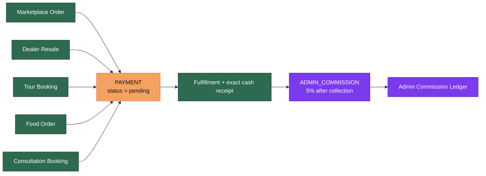
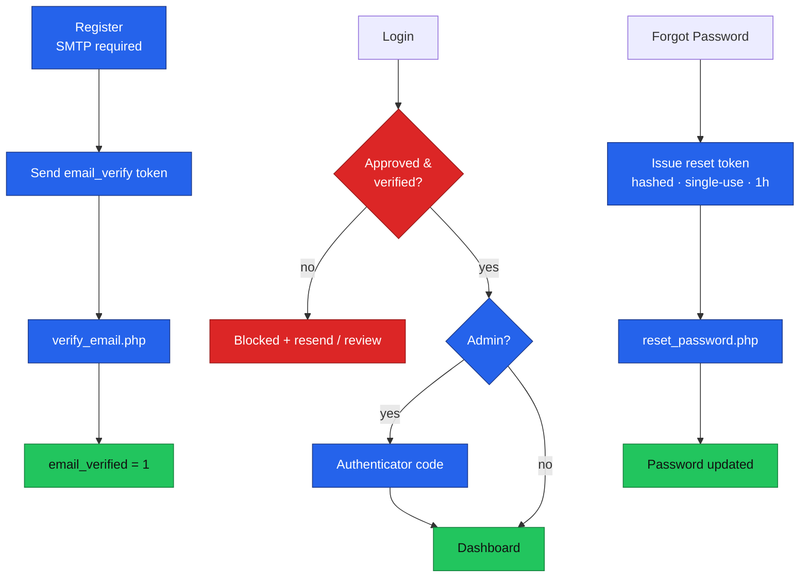
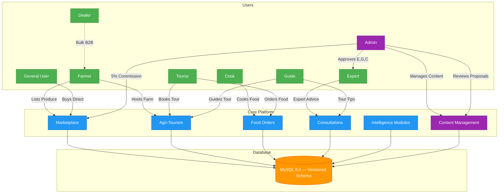
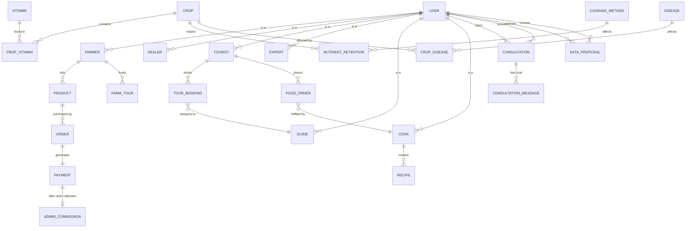

<div align="center">

# 🌱 KrishiDisha

### Agricultural Marketplace & Reference Platform
#### *Farm → Fork → Future*

<br/>

**Connecting farmers, dealers, tourists, experts, cooks, guides, and consumers through a shared marketplace and reviewed agricultural references.**

<br/>


<br/>

[](#quick-start)
[](#database-architecture)
[](#role-based-access-control)

</div>

---

## 🌍 What is KrishiDisha?

> **কৃষিদিশা** *(Krishi = Agriculture | Disha = Direction/Path)*

KrishiDisha is a PHP/MySQL platform for produce trading, agricultural services, and editorial reference information. Marketplace and booking actions are recorded in the database; cash receipt and payout records require people to confirm real transactions. Agricultural guidance is published only after source review.

| 🛒 Marketplace | 📚 Intelligence Hub | 🌿 Tourism Engine | 🤝 Consultation Network |
|:---:|:---:|:---:|:---:|
| Farmer and dealer produce orders, stock reservations, cash collection and 5% commission ledger | Reviewed crop/disease/nutrition references and a cost-based profit estimator | Farm tour bookings, guide scheduling and local food orders | Scheduled expert and guide consultations with in-app chat |

---

## ✨ What's New

<div align="center">


</div>

The platform now has transaction-safe operations and stronger access controls:

| Area | Enhancement |
|:-----|:------------|
| 🔁 **Dealer Marketplace** | Dealers procure farmer stock and resell from their own inventory; concurrent purchases lock stock rows and reject overselling |
| 💵 **Verified Cash Ledger** | Orders and bookings create pending payment records. A seller/admin records exact cash and a receipt after fulfillment; commission and payouts follow collection |
| 👤 **Self-Service Profiles** | Each role can edit its profile; password changes revoke existing sessions |
| 🍛 **Recipe Pricing** | Food orders use each cook's recipe price, approval and daily capacity |
| 🔒 **Account Security** | CSRF-protected POST actions, checked roles and account status, private uploads, rate limits, email verification and administrator TOTP |
| 🧾 **Support & Reconciliation** | In-app notifications, support tickets, cancellation/restocking rules, refunds and receipt-backed transfers |
| 🌾 **Reviewed References** | Crop, disease, nutrient and suitability records require source review before appearing as guidance; the calculator explains its assumptions |
| 🗄️ **Reproducible Schema** | A clean schema plus numbered migrations; the old demo seed is separate and is not loaded automatically |

### 💳 Unified Transaction & Commission Flow



### 🔑 Authentication & Recovery Flow



> ℹ️ Configure a real SMTP provider before opening registration. Verification and reset links are sent by email and are never shown in the browser. With no email service configured, registration stays closed.

---

## 🏗️ Platform Architecture



---

<a id="role-based-access-control"></a>
## 🎭 Role-Based Access Control

The platform checks the current database account status and role on protected requests. Each of the 8 roles has a dedicated dashboard and actions:

<table>
<tr>
  <th>Role</th>
  <th>Key Actions</th>
  <th>Core Dashboard Pages</th>
</tr>
<tr>
  <td>🛡️ <b>Admin</b></td>
  <td>Review provider accounts and references, moderate content, reconcile cash and payouts, handle support</td>
  <td><code>admin/dashboard.php</code> · <code>admin/manage_content.php</code> · <code>admin/knowledge.php</code> · <code>admin/approvals.php</code> · <code>admin/commissions.php</code></td>
</tr>
<tr>
  <td>🧑‍🌾 <b>Farmer</b></td>
  <td>Submit produce for approval, fulfill orders, host tours, book consultations</td>
  <td><code>farmer/produce.php</code> · <code>farmer/orders.php</code> · <code>farmer/bookings.php</code></td>
</tr>
<tr>
  <td>🏬 <b>Dealer</b></td>
  <td>Procure farmer stock, manage resale inventory and fulfill dealer sales</td>
  <td><code>dealer/inventory.php</code> · <code>dealer/sales.php</code></td>
</tr>
<tr>
  <td>🧳 <b>Tourist</b></td>
  <td>Book farm tours and consultations, order food, track payments and support</td>
  <td><code>tourist/tours.php</code> · <code>tourist/food_orders.php</code></td>
</tr>
<tr>
  <td>🧑‍🍳 <b>Cook</b></td>
  <td>Create authentic recipes, fulfill tourist food orders</td>
  <td><code>cook/recipes.php</code> · <code>cook/orders.php</code></td>
</tr>
<tr>
  <td>🔬 <b>Expert</b></td>
  <td>Accept scheduled crop and soil consultations and reply in chat</td>
  <td><code>expert/sessions.php</code></td>
</tr>
<tr>
  <td>🗺️ <b>Guide</b></td>
  <td>Guide farm tours and offer scheduled consultations with in-app chat</td>
  <td><code>guide/bookings.php</code> · <code>guide/sessions.php</code></td>
</tr>
<tr>
  <td>👤 <b>General User</b></td>
  <td>Browse farmer/dealer listings, buy produce, review reference tools</td>
  <td><code>user/marketplace.php</code> · <code>user/nutrition.php</code></td>
</tr>
</table>

---

## 🧩 Core Feature Modules

### 🛒 1. Direct-to-Consumer Marketplace

```
Farmer submits listing ──► Admin reviews ──► Buyer places order
                                                │
                                                ▼
                                     Stock reserved atomically
                                                │
                                                ▼
                               Seller delivers ──► Cash recorded
                                                         │
                                                         ▼
                                                  5% commission ledger
```

- Farmers submit produce with variety, grade, harvest date, pickup area, minimum order and optional photo; an administrator reviews publication.
- Buyers can purchase from farmers or dealer resale inventory. The relevant stock row is locked during checkout.
- Payments start pending. A seller or administrator records exact cash received against a receipt after fulfillment.
- The 5% commission is calculated from verified cash; seller proceeds and any payout or refund are tracked separately.

---

### 📖 2. Crop Encyclopedia

- Search across crop name, local (Bangla) name and available reference fields
- Filter by **Season** (Summer, Winter, Rainy, All Year) and **Category** (Grain, Vegetable, Fruit…)
- Each crop card displays its **uploaded photo** (falls back to category emoji)
- Users can suggest a crop for administrator review
- Only sourced, reviewed crop content appears as public guidance

---

### 🦠 3. Disease Reference Catalog

- Search by crop name or disease name
- Each disease card displays its **uploaded photo** where available
- Shows reviewed symptoms, plant part and treatment references where available
- Does not diagnose a plant from a photo or establish that a pesticide is appropriate for a specific farm

---

### 🧠 4. Dual-Mode Crop Recommender

```
┌─────────────────────────────────────┐
│          CROP RECOMMENDER           │
├──────────────────┬──────────────────┤
│  🗺️ By Region   │  💊 By Nutrition │
├──────────────────┼──────────────────┤
│  Select Division │  Select Vitamin  │
│  e.g. "Sylhet"  │  e.g. "Vitamin A"│
│        ▼         │        ▼         │
│  Ranked crops by │  Crops richest   │
│  suitability     │  in that vitamin │
│  score DESC      │  from DB         │
└──────────────────┴──────────────────┘
```

The scores are reviewed reference entries, not predictions. Users can suggest region–crop entries; administrators verify local season, soil, water and source before publishing.

---

### 🥗 5. Nutrition & Cooking Retention Analyzer

- Select a **crop** + **cooking method** (Boiling, Frying, Steaming, Raw)
- Shows reviewed raw amounts per 100 g and preparation-specific retention estimates where available
- Keeps missing data blank rather than treating it as zero
- Uses `CROP_VITAMIN`, `COOKING_METHOD` and `NUTRIENT_RETENTION`; units, source and preparation conditions need expert review

---

### 💰 6. Farm Profit Calculator

- JavaScript-powered, **no page refresh**
- Inputs include local land units, itemized costs, yield losses, expected price and commission
- Shows break-even values and low/base/high scenarios
- Recent active listing prices are labeled as seller asking prices, with sample count and pickup area; they are not a live official market feed

---

### 🌿 7. Agri-Tourism

```
Tourist ──► Books Farm Tour ─────────────────────► Farmer confirms
        └──► Guide date assigned ────────────────► Capacity/overlap checked
        └──► Orders Food ─────────────────────────► Cook fulfills
        └──► Books Expert ────────────────────────► Scheduled consultation
                                                          │
                                                 CONSULTATION_MESSAGE
                                                 table stores all msgs
```

- Tour cards can display reviewed farm photos where available
- Searchable by title or location
- Admin reviews pending tours; guide schedules and each booked day's capacity are checked

---

### 🛡️ 8. Admin Content Management System

A full CMS for the platform's editorial content:

```
admin/manage_content.php
│
├── 🌱 Crops Tab     — Review crop descriptions and source details
├── 🦠 Diseases Tab  — Review disease references and sources
├── 🌿 Tours Tab     — Review farm tour listings and photos
├── 🛒 Marketplace   — Review farmer-listed products
└── 📚 Knowledge     — Review nutrients, retention and suitability
```

- Uploaded images are decoded, re-encoded and stored in private media storage
- Live filterable tables for quick record management
- Content publication and proposals require recorded administrator review

---

### 📬 9. User Proposal & Admin Approval Workflow

Any authenticated user can **suggest new content** which enters a moderation queue:

```
User submits suggestion (modules/suggest.php)
         │
         ▼
DATA_PROPOSAL record created (status = 'pending')
         │
         ▼
Admin reviews in proposals.php
         │
    ┌────┴────┐
    ▼         ▼
Approve     Reject (with reason)
    │
    ▼
Validated before insertion into the correct table
(CROP / DISEASE / REGION_CROP / CROP_VITAMIN)
```

**Suggestion categories:**

| Section | What users can suggest |
|:--------|:----------------------|
| 🌱 Crop | New crop with photo, names, season, category, history |
| 🦠 Disease | New disease/pest with photo, symptoms, treatment |
| 📍 Region Suitability | Crop–region–soil suitability scores |
| 🧪 Nutrient Retention | Preparation-specific retention reference for crop + cooking method |

---

<a id="database-architecture"></a>
## 🗄️ Database Architecture

> The clean schema starts with the original relational model and numbered migrations add security, workflow, support and audit tables. Foreign keys and constraints protect key relationships.



### Notable Schema Additions

| Table | Purpose |
|:------|:--------|
| `DATA_PROPOSAL` | Stores pending user suggestions awaiting admin approval; `proposed_data` is JSON-encoded |
| `AUTH_TOKEN` | Hashed, single-use, expiring tokens for password reset and email verification |
| `USER.email_verified` | Email-confirmation flag used in login checks |
| `ORDER.dealer_inventory_id` | Links an order to a dealer's inventory (buyer↔dealer resale loop) |
| `RECIPE.price` | Per-recipe price set by the cook (drives food-order totals) |
| `CROP.image` · `DISEASE.image` · `FARM_TOUR.image` · `PRODUCT.image` | Paths to uploaded photos |
| `PAYMENT_SHARE` · `PAYMENT_REFERENCE` | Allocation and unique payment references for cash, payout and refund reconciliation |
| `MEDIA` · `AUDIT_LOG` · `REQUEST_RECORD` | Private upload metadata, action history and idempotency records |
| `SUPPORT_REQUEST` · `NOTIFICATION` | Account support and in-app updates |

### 🔒 Security & Data Integrity

| Layer | Implementation |
|:------|:---------------|
| **Password Security** | `password_hash()` + `password_verify()` — no plaintext storage |
| **Password Recovery** | Hashed, single-use, expiring reset tokens delivered through configured SMTP |
| **Email Verification** | New accounts must confirm their email; provider accounts also need administrator review |
| **CSRF Protection** | Session tokens on state-changing POST actions; mutation GET requests are rejected |
| **No Info Leaks** | DB exceptions logged server-side, never echoed to the client |
| **SQL Injection** | PDO Prepared Statements (`prepare()` + `execute()`) across all queries |
| **Atomic Transactions** | `BEGIN TRANSACTION … COMMIT` for multi-table operations (orders, payments) |
| **Access Control** | Protected requests recheck role, current account status, verification and authentication version |
| **Approval Gate** | Providers submit application details and wait for recorded administrator review |
| **Content Moderation** | All user-submitted content held in `DATA_PROPOSAL` with `pending` status until admin reviews |
| **Upload Validation** | JPG/PNG/WebP are decoded and re-encoded, size/dimension limited, given random IDs and stored privately |
| **Admin MFA** | TOTP authenticator and single-use recovery codes; first login requires enrollment |
| **Database Access** | Runtime uses a restricted account; migration service has schema privileges |

---

## ⚙️ Technology Stack

```
┌─────────────────────────────────────────────────────────────────┐
│                        KrishiDisha Stack                         │
├───────────────┬─────────────────────────────────────────────────┤
│  Frontend     │  HTML5 · Vanilla CSS (Custom Properties)         │
│               │  FontAwesome 6 Icons · Vanilla JavaScript         │
├───────────────┼─────────────────────────────────────────────────┤
│  Backend      │  PHP 8.4 · PDO · Sessions · PHPMailer             │
├───────────────┼─────────────────────────────────────────────────┤
│  Database     │  MySQL 8.4 · Versioned Migrations                │
├───────────────┼─────────────────────────────────────────────────┤
│  Environment  │  Docker · Docker Compose · Apache · phpMyAdmin    │
├───────────────┼─────────────────────────────────────────────────┤
│  Media        │  Private, validated JPG/PNG/WebP storage         │
└───────────────┴─────────────────────────────────────────────────┘
```

---

<a id="quick-start"></a>
## 🚀 Quick Start with Docker

> **Prerequisites:** [Docker Desktop](https://www.docker.com/products/docker-desktop/) and Python 3. Administrators need an authenticator app. Configuration generates unique local secrets; never commit `.env`.

```bash
# 1. Clone the repository
git clone https://github.com/Nazmul1005/Krishi-Disha.git
cd Krishi-Disha

# 2. Create private local configuration and start the app + database
python3 bin/configure.py
docker compose up -d --build

# 3. Create your administrator (a password is generated privately)
docker compose run --rm --no-deps migrate php bin/create-admin.php your-email@example.com

# 4. Visit the platform
# http://localhost:8080/KrishiDisha/
```

### 🌐 Access Points

| Service | URL |
|:--------|:----|
| 🌱 **KrishiDisha App** | [http://localhost:8080/KrishiDisha/](http://localhost:8080/KrishiDisha/) |
| 🗄️ **phpMyAdmin** *(optional)* | [http://localhost:8081/](http://localhost:8081/) after `docker compose --profile tools up -d phpmyadmin` |

### 🛑 Stopping the Application

```bash
docker compose down
```

### 📦 What Docker Does Automatically

```
docker compose up
      │
      ├─► Builds PHP 8.4 + Apache web server
      ├─► Starts MySQL 8.4 with a separate named volume
      ├─► Imports the clean schema on first database creation
      ├─► Runs versioned migrations and restricts the app DB account
      ├─► Creates private media storage
      └─► Serves the app on localhost:8080
```

The old demo SQL is retained for reference but is not imported by default. Registration remains closed until SMTP is configured in `.env`; verification and password recovery never reveal usable links in a browser. Keep the generated admin password private and enroll TOTP on first login. Existing databases need the [staged upgrade procedure](docs/DEPLOYMENT.md) before deployment.

---

## 📁 Project Structure

```
KrishiDisha/
│
├── 📄 public/index.php        # Only approved HTTP routes are exposed
├── 🐳 Dockerfile              # PHP + Apache container config
├── 🐳 docker-compose.yml      # Multi-container orchestration
│
├── 🔐 auth/                   # Login, email verification, recovery, MFA
├── ⚙️  config/                 # App, database and container configuration
├── 🔧 includes/               # Auth, transaction, media and shared helpers
│
├── 🛡️  admin/
│   ├── dashboard.php          # Admin overview & stats
│   ├── manage_content.php     # Review crops, diseases, tours, products
│   ├── knowledge.php          # Nutrient and suitability source review
│   ├── proposals.php          # Review user-submitted content
│   ├── approvals.php          # Review provider applications
│   ├── commissions.php        # Cash and commission ledger
│   └── users.php              # Manage all platform users
│
├── 🧑‍🌾 farmer/                 # Farmer produce, orders, tours, farmland
├── 🏬 dealer/                 # Dealer dashboard, inventory, sales
├── 🧳 tourist/                # Tourist dashboard, tours, food orders
├── 🧑‍🍳 cook/                   # Cook dashboard, recipes, orders
├── 🔬 expert/                 # Expert dashboard, consultation sessions
├── 🗺️  guide/                  # Guide dashboard, bookings, sessions
├── 👤 user/                   # General user marketplace & tools
│
├── 🧠 modules/                # Shared intelligence modules (all roles)
│   ├── encyclopedia.php       # Crop encyclopedia with search & photos
│   ├── disease.php            # Reviewed disease references
│   ├── recommend.php          # Reviewed regional/nutrition references
│   ├── nutrition.php          # Nutrient and retention references
│   ├── calculator.php         # Farm profit calculator
│   ├── tourism.php            # Agri-tourism listings with search & photos
│   ├── suggest.php            # User content suggestion portal
│   ├── book_consultation.php  # Consultation booking
│   ├── consultation_chat.php  # In-app consultation messages
│   ├── orders.php             # Buyer and seller order status
│   ├── payments.php           # Cash and payout records
│   └── support.php            # Private support requests
│
├── 🗄️  database/
│   ├── schema.sql             # Clean first-install schema
│   ├── migrations/            # Numbered upgrade steps
│   └── demo_seed.sql          # Optional legacy demonstration data
│
├── 🧪 tests/                  # Service, concurrency and browser checks
├── 📘 docs/                   # Deployment and implementation status
└── 🎨 assets/                 # Local styles, scripts, icons and fonts
```

---

## 🔄 Key Workflow Flows

### Authentication Flow
```
User visits the public site
        │
        ▼
   auth/login.php ──[Invalid]──► Generic error / rate limit
        │
   [Valid credentials]
        │
        ▼
Approved + email verified? ──[No]──► Verification / review
        │
   [Admin enrolls / completes MFA]
        │
        ▼
Role dashboard
        │
   [Every page load]
        │
        ▼
includes/auth_check.php rechecks role, status and auth version
→ Suspended or password changed? Session is revoked.
```

### Content Proposal Workflow
```
User fills suggest.php form (crop / disease / region / nutrition)
        │
        ▼
Optional validated photo stored privately
        │
        ▼
DATA_PROPOSAL row inserted (status = 'pending', proposed_data = JSON)
        │
        ▼
Admin opens proposals.php → sees data preview + photo thumbnail
        │
        ├──[Approve]──► Validated insert with review/source metadata
        │
        └──[Reject]───► Modal asks for reason → status = 'rejected', admin_notes saved
```

### Marketplace Transaction & Cash Collection
```
Buyer submits order ──► Lock stock + create order + pending PAYMENT
        │
        ▼
Seller confirms/delivers ──► Seller or admin records exact cash + receipt
        │
        ▼
Payment verified ──► 5% commission + seller allocations
        │
        ▼
Payout/settlement records use real transfer references
```

---

## 🧪 Verification & Responsible Use

```bash
npm ci
npm test
docker compose run --rm --no-deps migrate php tests/run.php
```

The service suite checks stock, permissions, retries, concurrent orders, booking conflicts, token reuse, cash collection and refunds. Browser checks use a separate disposable database. See the [deployment guide](docs/DEPLOYMENT.md) and [implementation status](docs/IMPLEMENTATION_STATUS.md) for operational checks. CI runs syntax, integration, dependency and image checks.

Agricultural material is a reviewed reference catalog, not a diagnosis or location-specific prescription. Unreviewed seed advice stays unpublished. Farmers and qualified local agronomists still need to validate crop varieties, season, water, soil, nutrient units, food handling and current pesticide labels before field use. The calculator uses assumptions and recent seller asking prices, not an official live market feed.

Email requires an SMTP service; no provider is bundled. Online payments, SMS, push notifications and official live data imports are not active integrations. Cash receipt records depend on operator confirmation. Publishing the repository does not deploy a production service; read [production and existing database instructions](docs/DEPLOYMENT.md) before rollout.

Reference links: [BAMIS district advisories](https://www.bamis.gov.bd/en/bulletin/district/), [DAM market reports](https://market.dam.gov.bd/?L=E), [DAE pesticide information](https://prism.dae.gov.bd/pesticide-list).

---

<div align="center">

---

**🌱 KrishiDisha — Bridging the field and the future, one harvest at a time.**

*Built for Bangladeshi agriculture using PHP · MySQL · Docker*

---

</div>
